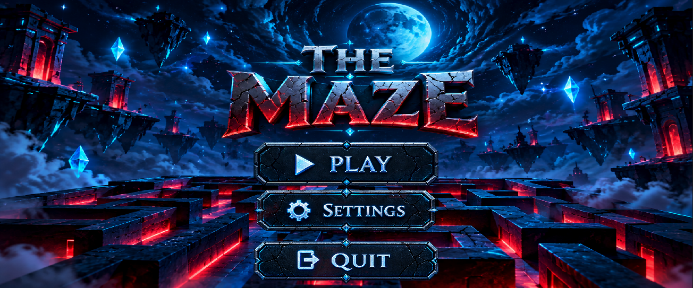

# The Maze

## Find the Key, Escape the Enemies, and Discover the Hidden Path!

## 🎮 Game Idea

`The Maze` is an exciting 3D adventure game built with Unity. Explore a mysterious maze, navigate through confusing paths, and escape from dangerous enemies while searching for the hidden key.

Your main objective is to find the key and use it to unlock the hidden wall that blocks your way to the exit.

Be careful! Enemies are lurking throughout the maze, and you must avoid them to survive and complete your mission.

## 🎯 Objective

- Explore the maze and discover the correct path.
- Find the hidden key.
- Escape from the enemies chasing you.
- Use the key to unlock the hidden wall.
- Reach the exit and complete the game successfully.

## 🕹️ How to Play

1. Start the game from the start screen.
2. Explore the maze and look for the key.
3. Avoid enemies while navigating through the corridors.
4. Find the key required to unlock the hidden wall.
5. Unlock the hidden wall to reveal the way forward.
6. Reach the exit to win the game.

## 📏 Game Rules

| Element | Result |
| --- | --- |
| 🗝️ Key | Unlocks the hidden wall |
| 👹 Enemies | Must be avoided to survive |
| 🧱 Hidden Wall | Blocks the path until unlocked |
| 🏁 Exit | The final destination and goal |

## 🏆 Game States

### Winning

The **You Win!** screen appears when the player successfully solves the maze, unlocks the hidden wall, and reaches the exit.

### Losing

The **Game Over** screen appears when the player fails to escape the dangers of the maze.

## 📂 Folder Contents

- `Start Background.png` - Main menu background.
- `Win Background.png` - Winning screen background.
- `GameOver Background.png` - Game Over screen background.
- `Assets/` - Game assets, including scripts, materials, models, and UI elements.
- `Scenes/` - Game scenes and level environments.

## 🚀 How to Run

### Play in Your Browser

1. Open the game's page on itch.io.
2. Click **Run Game** to launch the game.
3. Wait for the game to finish loading.
4. Follow the in-game instructions and begin your adventure.

### Open the Unity Project

1. Download or clone the project repository.
2. Open Unity Hub.
3. Select **Add Project from Disk** and choose the project folder.
4. Open the project using a compatible Unity version.
5. Open the main game scene.
6. Press the **Play** button to start playing.

## 📚 Learning Goals

- Designing and navigating a 3D maze.
- Implementing player movement and controls.
- Creating enemy behavior and avoidance mechanics.
- Detecting collisions and interactions.
- Implementing key collection mechanics.
- Unlocking hidden walls and blocked paths.
- Designing winning and losing game states.
- Creating UI screens and menus in Unity.
- Building and deploying a Unity WebGL game.

## 💡 Quick Summary

> **Explore the maze, escape the enemies, find the key, unlock the hidden wall, and make your way to freedom!**

---

Made with Unity

